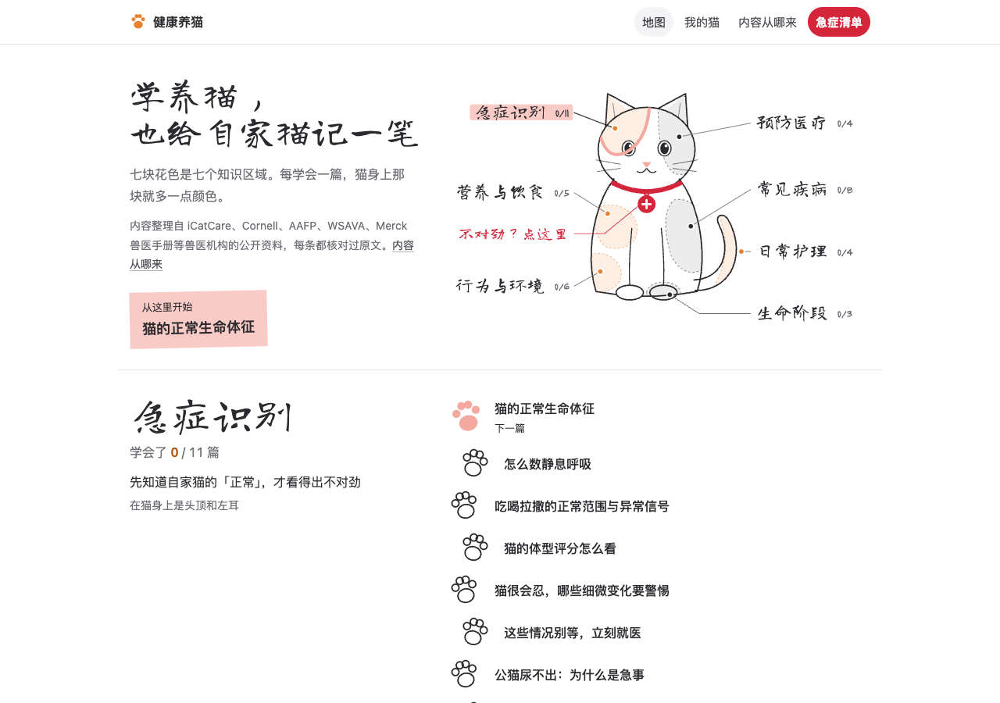
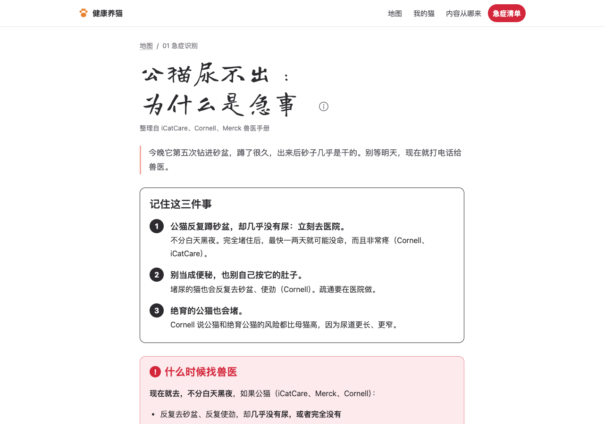
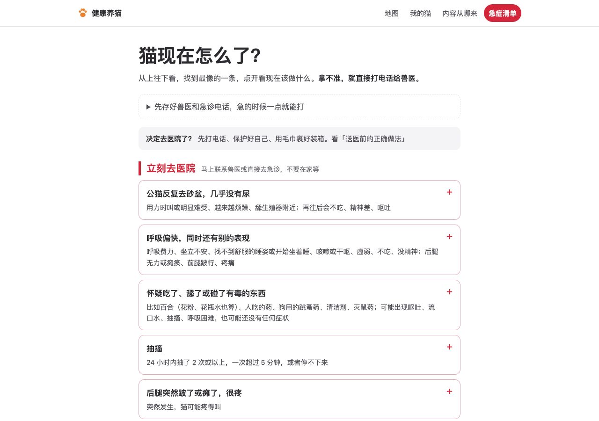
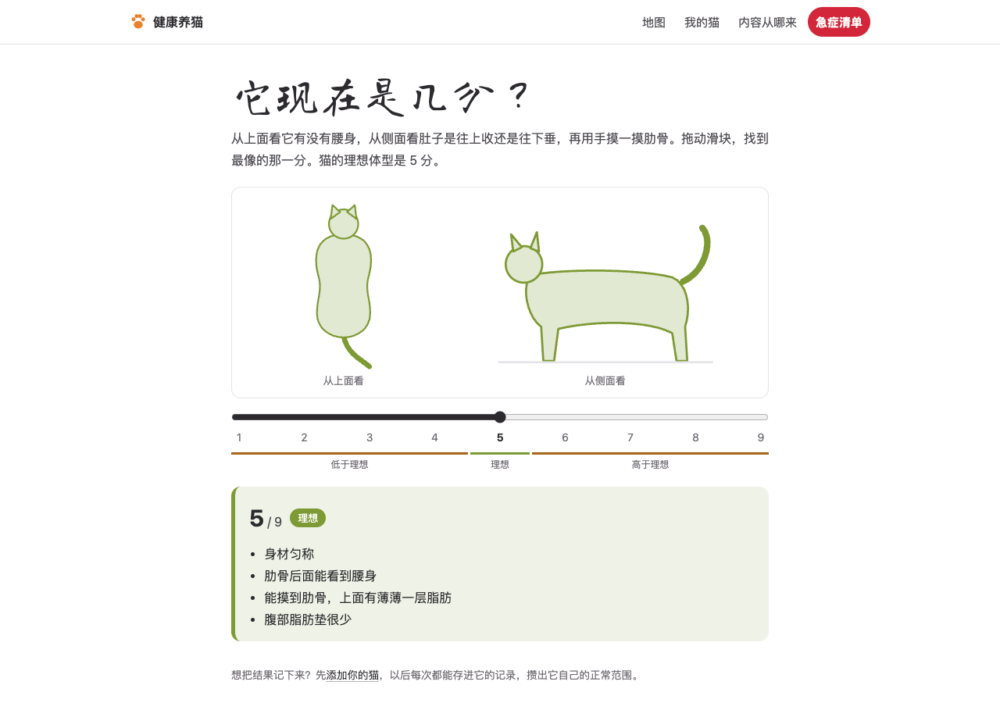

<div align="center">

# 🐾 CatCare

**Learn to care for your cat, and keep a record of your own.**

A free, open-source cat health site. Every fact is checked against the original pages of international veterinary organizations,<br>
and you can log your own cats day by day to learn what "normal" looks like for each of them.

[简体中文](README.md) · **English**

[**Open the site**](https://xiaoxiaostudy.github.io/catcare/)　·　[Emergency checklist](https://xiaoxiaostudy.github.io/catcare/emergency/)　·　[Where the content comes from](https://xiaoxiaostudy.github.io/catcare/about/)



</div>

> **Note:** the site itself is currently in Chinese only.

## Why

Cats hide pain well. By the time a cat *looks* unwell, the problem has often been going on for days.

There is plenty of cat advice online, but sources are mixed and often contradict each other. This project does two things:

1. **Explain reliable knowledge clearly.** Content is drawn only from material that International Cat Care, the Cornell Feline Health Center, the Merck Veterinary Manual, AAFP and WSAVA publish for cat owners. Every fact is cited and checked against the original page.
2. **Help you notice when your cat is different.** Every cat's "normal" is a little different. After a few days of logging, the site works out your cat's own range and tells you when something is off.

## What's inside

| | |
|---|---|
| 🗺️ **Learning map** | The home page is a calico cat. Its seven patches are seven areas: recognizing emergencies, preventive care, nutrition, common diseases, behavior & environment, life stages, daily care. Each note you finish fills in a bit more color. |
| 📖 **41 notes** | Each opens with "remember these things", then answers the questions you'd actually ask: what's normal, how to check, when to call the vet, what not to do. Each ends with a short quiz. |
| 🚨 **Emergency checklist** | "What's wrong with my cat right now?" Find the closest match and see what to do next. Save your vet's number; print it if you like. |
| 🐱 **My cats** | Profiles for each cat. Log breathing rate, weight, eating, drinking and litter box, plus vaccines and parasite control. After 5 days it calculates your cat's own baseline and flags readings that differ. |
| 🧰 **11 interactive tools** | Breathing / heart-rate timers, body condition score, food and water calculators, litter box checks, a household-toxin hunt, cat body language, cat-to-human age… |

<table>
<tr>
<td width="50%"><br><sub>A note: key points first; red boxes mean go to the vet now</sub></td>
<td width="50%"><br><sub>Emergency checklist: find the closest match</sub></td>
</tr>
<tr>
<td width="50%"><br><sub>Body condition score, translated line by line from the WSAVA chart</sub></td>
<td width="50%" valign="top">

**Privacy:** everything in "My cats" stays in your own browser. Nothing is uploaded and no sign-up is needed. You can export a backup at any time.

**Sources:** each note lists the organizations it relies on, with links to the original pages and the date they were checked.

</td>
</tr>
</table>

## ⚠️ Please note

The author is a cat owner, not a vet, and the notes have not yet been reviewed by a veterinarian. The site can help you understand your cat and know when to seek help, **but it does not replace a vet's diagnosis**. When in doubt, call your vet.

## Contributing

Help is very welcome, especially:

- **Vets and vet students:** reviewing notes is what this project needs most.
- **Corrections:** if something is wrong or a source is out of date, please [open an issue](https://github.com/xiaoxiaostudy/catcare/issues), ideally with a link to the original page.
- **Translation:** an English version of the site is something we'd love to have.

If you find it useful, a ⭐ star helps other cat owners find it.

## Run locally

A static site built with [Astro](https://astro.build/); "My cats" and the tools are Preact components.

```bash
npm install
npm run dev
```

Notes live in `src/content/notes/`, one Markdown file each; the learning map is in `src/data/map.ts`. Pushing to `main` deploys to GitHub Pages via GitHub Actions.

## License

- **Code:** [MIT](LICENSE)
- **Notes, figures and emergency checklist text:** [CC BY-NC-SA 4.0](LICENSE-CONTENT). You're welcome to share and adapt them: credit us with a link, don't use them commercially, and release adaptations under the same license.

## Acknowledgements

Content is drawn from material published by these organizations, who hold its copyright:
[International Cat Care](https://icatcare.org/), [Cornell Feline Health Center](https://www.vet.cornell.edu/departments-centers-and-institutes/cornell-feline-health-center), [Merck Veterinary Manual](https://www.merckvetmanual.com/), [AAFP](https://catvets.com/), [WSAVA](https://wsava.org/).

For Mianmian and Miaomiao.
