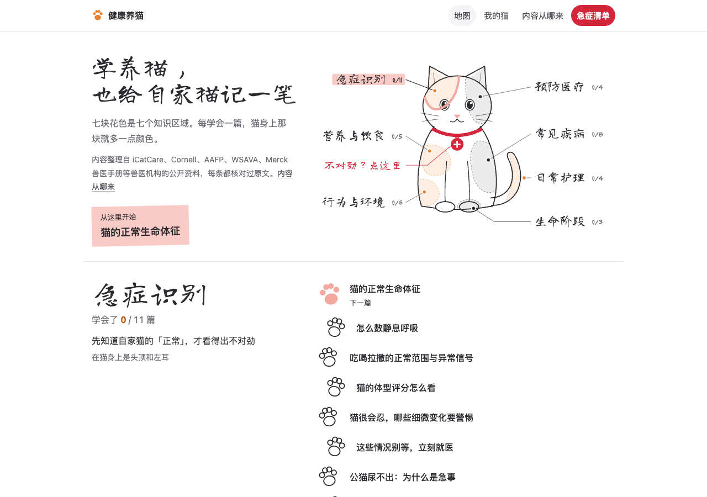
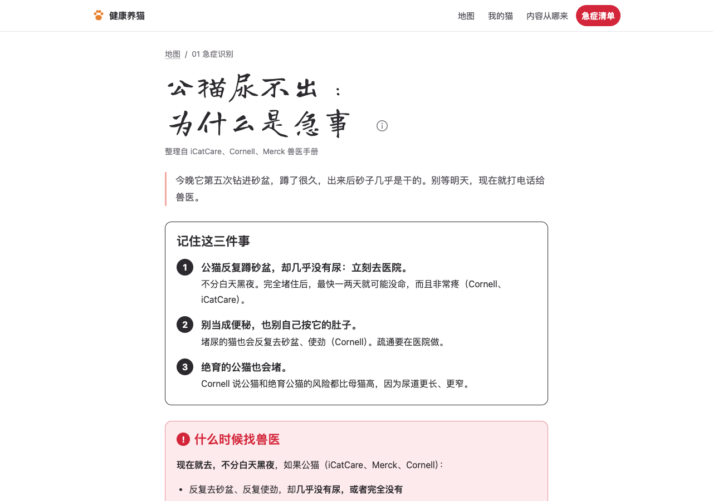
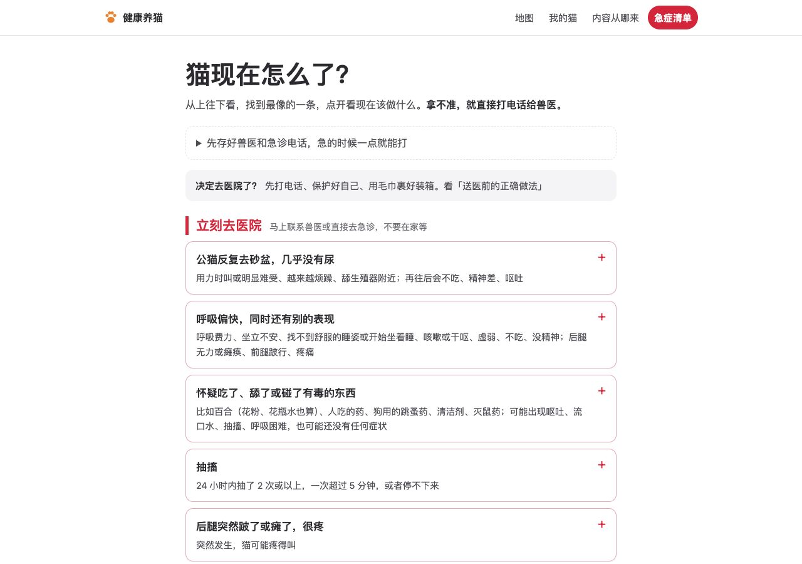
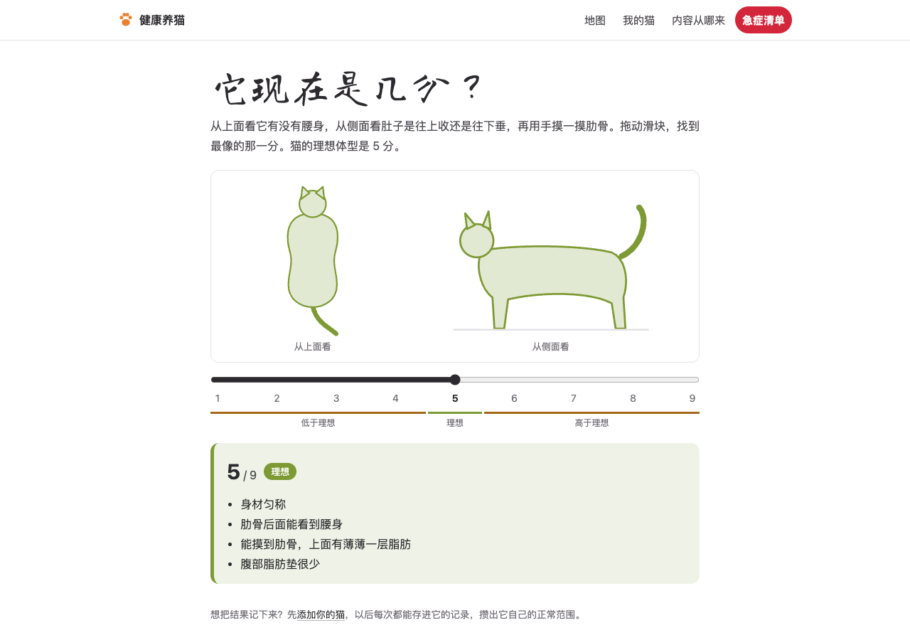

<div align="center">

# 🐾 健康养猫

**学养猫，也给自家猫记一笔。**

一个免费、开源的养猫知识网站：每条知识都回到国际兽医机构的原网页核对过，<br>
还能给自家猫建档、每天记录，攒出它自己的「正常范围」。

**简体中文** · [English](README.en.md)

[**打开网站**](https://xiaoxiaostudy.github.io/catcare/)　·　[急症清单](https://xiaoxiaostudy.github.io/catcare/emergency/)　·　[内容从哪来](https://xiaoxiaostudy.github.io/catcare/about/)



</div>

## 为什么做这个

猫很会忍。等它看起来「明显不舒服」，往往已经拖了好几天。

网上的养猫知识很多，但来源混杂，说法互相打架。这个项目只做两件事：

1. **把靠谱的知识讲清楚。** 只整理 iCatCare、康奈尔大学猫健康中心、默克兽医手册、AAFP、WSAVA 这些兽医机构公开给养猫人的资料，每条事实标出处、回原网页核对。
2. **帮你看出自家猫哪里不一样。** 每只猫的「正常」都不一样。记录几天之后，网站会算出它自己的范围，偏离了就提醒你。

## 有什么

| | |
|---|---|
| 🗺️ **学习地图** | 首页是一只三花猫，七块花色是七个知识区域：急症识别、预防医疗、营养与饮食、常见疾病、行为与环境、生命阶段、日常护理。每学会一篇，猫身上那块就多一点颜色。 |
| 📖 **41 篇知识笔记** | 每篇先给「记住这几件事」，再按你会问的问题分节：正常是多少、怎么测、什么时候找兽医、别这样做。最后有「考考自己」。 |
| 🚨 **急症清单** | 「猫现在怎么了？」从上往下找最像的一条，点开就知道现在该做什么。可以存好兽医电话，也能打印。 |
| 🐱 **我的猫** | 给每只猫建档，记录呼吸、体重、吃喝拉撒，以及疫苗和驱虫。满 5 天后算出它自己的正常范围，和平时不一样就提醒。 |
| 🧰 **11 个互动小工具** | 呼吸 / 心跳计时器、体型评分、喂多少、喝多少水、砂盆观察、给砂盆打分、找危险物、读懂肢体语言、年龄换算…… |

<table>
<tr>
<td width="50%"><br><sub>知识笔记：先给结论，红框是要马上就医的情况</sub></td>
<td width="50%"><br><sub>急症清单：从上往下找最像的一条</sub></td>
</tr>
<tr>
<td width="50%"><br><sub>体型评分：拖动滑块，文字逐条译自 WSAVA 对照表</sub></td>
<td width="50%" valign="top">

**隐私**：「我的猫」的所有数据只存在你自己的浏览器里，不上传、不需要注册。可以随时导出备份。

**依据**：每篇笔记标题下写着依据了哪几家机构，篇末有原网页链接和核对日期。

</td>
</tr>
</table>

## ⚠️ 请注意

作者是养猫人，不是兽医。目前笔记还没有经过兽医审核。这个网站能帮你看懂猫、知道什么时候该去医院，**但不能代替兽医的诊断**。拿不准的时候，直接打电话给兽医。

## 参与进来

很欢迎帮忙，尤其是：

- **兽医或兽医学生**：帮忙审核笔记，是这个项目现在最缺的。
- **发现错误**：哪里写错了、来源过期了，请 [开一个 Issue](https://github.com/xiaoxiaostudy/catcare/issues)，最好附上原网页链接。
- **想看的主题**：地图上还有没写的主题，告诉我你最想先看哪篇。

觉得有用的话，点个 ⭐ Star，让更多养猫的人看到。

## 本地运行

用 [Astro](https://astro.build/) 做的静态网站，「我的猫」和互动工具是 Preact 组件。

```bash
npm install
npm run dev
```

笔记在 `src/content/notes/`，一篇一个 Markdown；学习地图在 `src/data/map.ts`。推送到 `main` 后由 GitHub Actions 自动发布到 GitHub Pages。

## 致谢

知识内容整理自以下机构公开的资料，版权归原机构所有：
[International Cat Care](https://icatcare.org/)、[Cornell Feline Health Center](https://www.vet.cornell.edu/departments-centers-and-institutes/cornell-feline-health-center)、[Merck Veterinary Manual](https://www.merckvetmanual.com/)、[AAFP](https://catvets.com/)、[WSAVA](https://wsava.org/)。

献给绵绵和妙妙。
